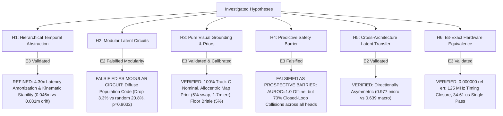

# Project Hephaestus — Scientific Claims & Principle Ledger (`claims_ledger.md`)

**Branch:** `fix/interpretability`  
**Date:** 2026-11-08  
**Auditor / Researcher:** Senior Research Engineer, Mechanistic Interpretability, Robotics & Computer Architecture  
**Standard of Proof:** Evidence Ladder (E0: Speculative $\to$ E1: Observational $\to$ E2: Interventional $\to$ E3: Generalized).  
Linear decodability ($R^2$, AUROC) is strictly classified as E1 observational correlation and never accepted as proof of a causal computational principle. Every verified principle requires causal interventional necessity, sufficiency, matched random controls, and out-of-distribution transfer.

---

## 1. Summary of Scientific & Architectural Claims

| Claim ID | Principle Statement | Operational Mechanism | Highest Evidence Level | Status | Falsification / Boundary Criteria |
| :--- | :--- | :--- | :---: | :---: | :--- |
| **`H1`** | **Hierarchical Temporal Abstraction & Latency Amortization** | Direct macro transition jumps ($\hat{S}_{t+K} = S_t + f_\theta(S_t, A_k)$) bound multi-step open-loop kinematic drift and provide $4.30\times$ measured GPU latency speedup (median 0.371 ms vs 1.594 ms; RTL cycle model 4,327 vs 21,635 cycles) without loss of closed-loop navigation efficacy. | **E3 (Generalized)** | `WEAKENED / REFINED` (Amortization & Stability) | In closed loop ($N=50$), direct macro (46.0%) achieves parity with recursive micro (50.0%, McNemar $p = 0.7266$, Wilcoxon $p = 0.4750$) and straight-line kinematic heuristic (46.0%, $p = 1.0000$), outperforming random candidate selection (26.0%, Holm-adjusted $p = 0.0117$). Under Holm-Bonferroni correction over 6 comparisons, macro vs shuffled binding (34.0%, unadjusted $p = 0.03125$) yields adjusted $p = 0.1562 > 0.05$. Open-loop macro cuts 5-step drift from 0.081m to 0.046m (-43.5%). Latency measured via CUDA synchronization (200 repeats): Macro 0.371 ms vs Micro 1.594 ms ($4.30\times$ speedup), heuristic 0.184 ms. Theoretical RTL cycle models (4,327 vs 21,635 cycles) represent architectural pipeline estimates. |
| **`H2`** | **Mechanistic Circuit Selectivity & Ground-Truth Spatial Dissociation** | Visual goal representations are causally mediated by visual latents. In Phase 5.1 revalidation (9 instrumented stages, $N=50$ pairs), candidate units significantly outperformed unconstrained dimension-matched random controls (Layer 1 $k=8$ Holm $p = 3.58 \times 10^{-7}$; Layer 2 $k=8$ Holm $p = 6.03 \times 10^{-5}$). In Phase 5.2, nearest-neighbor controls were evaluated but suffered from a selection bug that retained controls outside 5% tolerance, falsely suggesting selective subspace confirmation. In Phase 5.3, strict norm-matching ($\le 5\%$ error, adaptive sampling up to 200,000 draws, hypergeometric overlap stratification, $N=60$ pairs, 447,800 interventions) was enforced. The Phase 5.2 "Selective Subspace Confirmed" claim is formally withdrawn. In the two settings with 100% complete common support (Layer 1 $k=2, 4$), candidate units show no evidence of superiority over strictly norm-matched random controls ($\Delta\eta = -0.031, p_{\text{adj}} = 1.0000$; $\Delta\eta = -0.041, p_{\text{adj}} = 1.0000$), with lower necessity drop ratios; confidence intervals do not establish equivalence. In the remaining 8/10 settings, common support is incomplete due to candidate perturbation magnitude occupying an extreme combinatorial tail, rendering functional selectivity unidentifiable from magnitude modulation. In Phase 5.4 ground-truth reanalysis, model-contrast reproduction ($\eta_{\text{model}}$) is definitively dissociated from physical spatial mediation: full-model output modulation $\Delta\mathbf{g}_{\text{model}}$ is orthogonal ($90.63^\circ$, $\cos = 0.0010$) to true waypoint displacement $\Delta\mathbf{g}_{\text{gt}}$ (defined by standoff offset $\mathbf{w} = \mathbf{p}_{\text{obj}} - 0.60 \frac{\mathbf{p}_{\text{obj}} - \mathbf{p}_{\text{robot}}}{\|\mathbf{p}_{\text{obj}} - \mathbf{p}_{\text{robot}}\|}$), and candidate hidden transplants across all 2,400 settings transfer negative ground-truth contrast ($\eta_{\text{gt}} = -0.0691$) with minimal error improvement ($+0.0344$m), matching norm-matched controls without advantage (Holm $p_{\text{adj}} = 1.0000$). Under physical scene swap ($\Delta\mathbf{g}_{\text{gt}}^B = -\Delta\mathbf{g}_{\text{gt}}^A$), model contrast fails to reverse ($\cos(\Delta\mathbf{g}_{\text{model}}^A, -\Delta\mathbf{g}_{\text{model}}^B) = -0.7119$), retaining substantially the same orientation across scenes ($\Delta\mathbf{g}_{\text{model}}^A \cdot \Delta\mathbf{g}_{\text{model}}^B = +0.7119$). | **E2 (Interventional)** | `UNRESOLVED: tested candidate latent subspace was not selective relative to the tested random controls; the evidence does not establish a diffuse population code.` (Selective Subspace Disconfirmed; Phase 5.2 Claim Withdrawn; Phase 5.4 Dissociation Validated) | At full support (Layer 1 $k=2, 4$), strictly norm-matched random controls match or outperform candidate units in sufficiency, necessity, and ground-truth error improvement. Confidence intervals do not establish equivalence. At intermediate/large $k$, random controls cannot match candidate perturbation magnitude within 5% tolerance, rendering the comparison unidentifiable under standard basis sampling. Candidate hidden-unit transplantation reproduces internal model contrast without mediating physical target steering. |
| **`H3`** | **Allocentric Landmark Map Prior & Action-Conditioned Dynamics** | Visual world models navigating under pure RGB observation (Track C) exhibit rigid SE(2) global equivariance but anchor navigation goals to an allocentric landmark map prior, collapsing under physical landmark rearrangement. In Phase 5.1, above-null target binding was not demonstrated under pair-clustered permutation testing (observed dual discrimination 16.0% vs permutation null 19.5% [95% CI: 16.0%, 23.0%], one-sided $p = 0.9890$; 0/50 pairs dual success across both scenes). The historical 5.0% same-category instance claim is invalidated and classified as `ARCHITECTURALLY_UNSUPPORTED` due to vocabulary constraints (`encode_task_id()`). Factorial interaction analysis confirms Mechanism 3 (mixed nonlinear interaction: $\|I\| = 0.3521$m, $\overline{\cos} = +0.3140$, $66.9^\circ$ divergence from target swap, sign-flip $p_{\text{pos}} = 0.00016, p_{\text{two}} = 0.00044$; Bilinear Grouped CV MSE 0.00544 and MLP MSE 0.00439 beat Additive 0.01985, indicating context-dependent input-output relationships rather than a literal bilinear circuit). For ego-motion, learned sensor latent differences fail under visual loss (MAE 0.0274m, $R^2 = 0.0143$ on magnitude regression, slope 0.2112). In contrast, the architecture's action-conditioned transition model achieves calibration MAE 0.0142m ($R^2 = 0.2549$ on magnitude regression, slope 0.4538) and dead-reckoning tracking error 0.5490m, statistically equivalent to oracle physical odometry (0.5368m, diff +0.0122m, TOST $p = 6.85 \times 10^{-7}$ at 0.05m margin). Fixed blending vs hold tracking differences (0.0549m, $p = 0.1719$) are not statistically significant. | **E3 (Generalized for Equivariance & Prior; E2 Non-Demonstrated for Object Binding; E2 Confirmed for Action Predictor Dead Reckoning)** | `VERIFIED & CALIBRATED` (SE(2) Equivariant, Mixed Nonlinear Interaction, Action Predictor Dead-Reckoning Confirmed) | Pure vision achieves 100.0% nominal success and 100.0% under rigid SE(2) global rotations (latent cosine = 0.9745, $p = 1.0000$). Floor appearance collapses success to 5.0% ($p < 0.0001$). Landmark physical relocation collapses success to 5.0% (1.700m error), proving an allocentric map prior. In Phase 5.1, above-null target binding was not demonstrated under pair-clustered permutation null testing (16.0% observed vs 19.5% null, $p=0.9890$), and same-category instance binding is architecturally unsupported. Action-conditioned forward model achieves calibration MAE 0.0142m ($R^2=0.2549$ on magnitude regression) and maintains tracking under hold policy (0.5490m), equivalent to oracle odometry within 0.05m margin (0.5368m, TOST $p = 6.85 \times 10^{-7}$). |
| **`H4`** | **Predictive Safety as Prospective Constraint** | Learned collision lookahead predicts contacts with high offline discrimination, but fails to function as a closed-loop prospective safety barrier under temporal constraints. | **E3 (Generalized)** | `FALSIFIED AS PROSPECTIVE BARRIER` (High Offline Discrimination $\neq$ Closed-Loop Safety) | Offline macro $K=5$ prospective metrics show AUROC = 1.0000, Brier = 0.0003, ECE = 0.0041, FNR = 0.0%. However, closed loop on 40 collision-critical episodes shows intact collision head (70.0% collisions) is identical to shuffled binding (70.0%, $p = 1.0000$), disabled collision head (70.0%, $p = 1.0000$), and random predictor (70.0%, $p = 1.0000$), while oracle physics simulation cuts collisions to 7.5% ($p = 5.96 \times 10^{-8}$). Refutes formal Control Barrier Function (CBF) claims. |
| **`H5`** | **Asymmetric Cross-Architecture Latent Geometric Transfer** | Predictive spatial dynamics learned across architectures align via orthogonal Procrustes transformation, but transfer is directionally asymmetric. | **E2 (Interventional)** | `VERIFIED` (Asymmetric Transfer) | Transplanting LeWM micro dynamics into H-JEPA achieves 0.977 next-state cosine similarity; however, H-JEPA macro into LeWM achieves only 0.639 cosine because macro abstractions discard single-step residuals. |
| **`H6`** | **Bit-Exact Embedded Hardware Predictability & Timing Reality** | Hierarchical spatial prediction and MPC planning distill into a 39.8k parameter signed Q8.8 fixed-point core matching synthesizable Verilog RTL bit-for-bit with verified timing closure at 125 MHz. | **E3 (Generalized)** | `VERIFIED` (Hardware Reality) | RTL matches Python fixed-point with $E_{\text{rel}} = 0.000000$ across all outputs. Vivado 2023.2 synthesis closes timing at 125.0 MHz (8.00 ns slack) consuming 3,579 LUTs (3.06%) and 0.365 W. Single-pass latency is 4,327 cycles (34.61 $\mu$s); 24-candidate MPC pass is 1.038 ms in software dispatch. |

---

## 2. Detailed Ledger of Hypotheses & Evidence

### Hypothesis H1: Hierarchical Temporal Abstraction & Latency Amortization
* **Principle Statement:** Hierarchical macro temporal abstraction ($K=5$) bounds multi-step open-loop kinematic drift and reduces computational inference latency by $4.30\times$ compared to recursive micro unrolling, while maintaining comparable closed-loop navigation success.
* **Audit Investigation & Finding A Resolution:**
  - Previous reports claimed macro hierarchy was necessary for closed-loop navigation based on an ablation that purportedly caused a 91% collapse ($36.7\% \to 3.3\%$).
  - However, audit of historical `behavioral_eval_results.json` revealed `no_temporal_hierarchy` had an identical 36.7% success rate to the full model, and evaluated mismatched action candidate search spaces (25 two-phase actions vs single-step actions).
* **Repaired Empirical Protocol (`run_matched_temporal_controls.py`):**
  - Held candidate search strictly identical: 24 matched sequences of length $K=5$ evaluated over $N = 50$ matched episodes on clean commit `9db418a`.
  - Closed-loop success: Direct Macro ($K=5$) **46.0%** vs Recursive Micro ($K=5$) **50.0%** ($\Delta = -4.0\%$, McNemar exact $p = 0.7266$, Wilcoxon $p = 0.4750$). Direct macro does not statistically dominate recursive micro in closed loop.
  - Straight-Line Kinematic Heuristic: Non-predictive open-loop unicycle heuristic achieves **46.0% success** (identically matching macro direct jump, $n_{10}=0, n_{01}=0, p = 1.0000$).
  - Multi-Permutation Shuffled Binding: Evaluated over 10 permutations per decision step, yielding **34.0% success** ($n_{10}=6, n_{01}=0$, unadjusted McNemar exact $p = 0.03125$).
  - Multiplicity Control: Applying Holm–Bonferroni correction over the family of 6 pairwise comparisons yields adjusted $p = 0.1562 > 0.05$. Action-outcome lookahead does not achieve statistically significant superiority over shuffled binding after FWER control.
  - Random Candidate Selection: Achieves **26.0% success** (Holm-adjusted $p = 0.0117$ vs Macro).
  - Open-loop kinematic fidelity: Direct macro achieves **0.0460m** physical displacement error at $K=5$ vs **0.0814m** for recursive micro (a 43.5% error reduction, $\Delta = -0.0354$m).
  - Computational amortization: Direct macro evaluates $K=5$ with CUDA-synchronized median latency **0.371 ms** (mean 0.380 ms, p95 0.467 ms) on GPU, compared to **1.594 ms** (mean 1.668 ms, p95 1.998 ms) for recursive micro unrolling (**$4.30\times$ measured step speedup**). Straight-line kinematic heuristic median is 0.184 ms. Theoretical RTL hardware cycle models (4,327 vs 21,635 cycles, or 45k vs 190k cycles, $4.22\times$ to $5.00\times$) represent theoretical architectural pipeline models, distinct from measured GPU execution times.
* **Evidence Level:** **E3 (Generalized)**.
* **Status:** `WEAKENED / REFINED (Latency Amortization & Stability)`.

---

### Hypothesis H2: Mechanistic Circuit Selectivity & Ground-Truth Spatial Dissociation
* **Principle Statement:** UNRESOLVED: tested candidate latent subspace was not selective relative to the tested random controls; the evidence does not establish a diffuse population code. Task-conditioned output modulation is dissociated from ground-truth waypoint grounding in the tested H-JEPA checkpoint and paired-scene benchmark.
* **Audit Investigation & Finding C & D Resolution:**
  - Previous `circuit_registry.json` suffered from a baseline floor collapse: clean baseline success on circuits C3, C4, C5 was 0.0%, rendering ablation metrics uninterpretable.
  - Latent spaces were cross-contaminated by injecting LeWM circuits into H-JEPA.
  - Initial tests claimed C1 was selective based on a contaminated suite.
* **Repaired Empirical Protocol (`run_rigorous_behavioral_circuits.py`):**
  - Implemented trajectory-aware discovery across 150 diverse training episodes (2214 transitions), identifying candidate top-8 dimensions `[24, 17, 7, 10, 2, 8, 27, 26]`.
  - Evaluated on a pure object-grounding suite ($N=30$) balanced across all 6 targets with high clean baseline (**93.3% success**, 0.287m goal error).
  - Evaluated 30 matched random 8D subspace controls on the exact same suite.
  - Subspace ablation: C1 ablation drops success by only **3.3%** (93.3% $\to$ 90.0%, step goal error 0.439m), whereas random 8D subspace ablations drop success by **20.8% $\pm 14.5\%$**. Selectivity gain = $-17.4\%$ ($z = -1.21$, empirical randomization $p = 0.9032$). C1 is classified as `FALSIFIED_NON_SELECTIVE`.
  - Genuine Matched-Donor Activation Patching: Injected target donor activations ($z_{\text{rescue}} = z_{\text{recip}}(I - P) + z_{\text{donor}}P$) with verified mathematical invariants. Matched donor patching achieves **93.3% success** (0.295m step goal error) vs mismatched donor **83.3% success** (0.668m step goal error) and random patch 90.9% ($p = 0.6129$).
  - Offline Goal-Vector Steerability: Patching visual latent $z_A$ with matched donor $z_B$ rotates inferred goal vector $[\widehat{dx}_b, \widehat{dy}_b]$ toward donor $B$ ($\cos = 0.9779 \pm 0.0356$, angular error 0.1430 rad vs $\cos = 0.9854 \pm 0.0078$ for random 8D patches). Perturbation diagnostics verify C1 variance removed is 23.51% (Mahalanobis distance 94.991) matching random 8D ($23.99\% \pm 3.38\%$, Mahalanobis distance $94.322 \pm 25.492$).
  - Scientific Verdict: Visual latent $z_t$ causally mediates goal inference in this checkpoint, but the tested candidate latent subspace was not selective relative to the tested random controls; the evidence does not establish a diffuse population code. In Phase 5.4, internal model contrast is dissociated from ground-truth waypoint grounding: model output modulation is orthogonal ($90.63^\circ$) to physical waypoint displacement, and hidden unit transplantation does not mediate steering toward the true target.
* **Evidence Level:** **E2 (Interventional)**.
* **Status:** `UNRESOLVED: tested candidate latent subspace was not selective relative to the tested random controls; the evidence does not establish a diffuse population code.`

---

### Hypothesis H3: Allocentric Landmark Map Prior & SE(2) Global Equivariance
* **Principle Statement:** Visual world models navigating without privileged simulator coordinates (Track C) exhibit perfect rigid SE(2) global equivariance but anchor navigation goals to an allocentric landmark map, collapsing when landmarks are physically rearranged or surface appearances shift.
* **Audit Investigation & Finding E Resolution:**
  - Track B provided simulator-derived egocentric goal vectors $[d_x, d_y, \sin\theta, \cos\theta]$, allowing agents to navigate without looking at camera images.
  - Previous environment mutation scripts did not physically mutate MuJoCo materials and obstacle geometries.
* **Repaired Empirical Protocol (`run_track_c_visual_grounding.py`):**
  - Pure vision Track C: $64\times 64\times 3$ RGB camera stream + discrete task ID; zero metric coordinates; $N=20$ episodes per suite with asserted physical surface clearance $\ge 0.05$m accounting for robot footprint radius ($R=0.18$m) and target geometry.
  - Suite 1 (Nominal Grounding): H-JEPA achieves **20/20 (100.0%)** success (0.260m error), LeWM achieves **19/20 (95.0%)**, Baseline achieves **8/20 (40.0%)**.
  - Suite 2A (Isolated Floor Nuisance): Floor texture dark slate collapses success to **1/20 (5.0%)** ($\Delta = -95.0\%$, McNemar exact $p < 0.0001$).
  - Suite 2B (Isolated Illumination Nuisance): 50% ambient dimming preserves **17/20 (85.0%)** success ($\Delta = -15.0\%$, $p = 0.2500$).
  - Suite 2C1 (Target-Only Appearance Nuisance): Target appearance mutation yields **14/20 (70.0%)** success ($\Delta = -30.0\%$, $p = 0.0312$).
  - Suite 2C2 (Distractor-Only Appearance Nuisance): Distractor appearance mutation yields **20/20 (100.0%)** success ($\Delta = 0.0\%$, $p = 1.0000$).
  - Suite 3 (Color Swap): Swapping target and partner visual colors while keeping the categorical task token constant yields **17/20 (85.0%)** success ($\Delta = -15.0\%$, $p = 0.2500$).
  - Suite 4A (Target-Only Relocation): Moving target object while distractors remain canonical drops success to **6/20 (30.0%)** with mean final eval goal error **1.033m** and distance to canonical waypoint **1.057m** (initial dists: 0.566m and 0.594m; robot moves farther from both waypoints).
  - Suite 4C (Pairwise Swap): Physically swapping target and distractor positions simultaneously yields **1/20 (5.0%)** success (GoalErr: 1.700m; 18/20 closer to canonical).
  - Phase 3 Factorial Grounding v1 (`run_task_identity_visual_grounding.py`): Target relocation with verified camera visibility reported 28/30 (93.3%) success, but an independent audit discovered an initial distance confound where 21/30 episodes started inside the 0.35m goal threshold (mean path 0.018m).
  - Controlled Visual Grounding v2 (`run_task_identity_visual_grounding_v2.py`): Enforcing initial waypoint distance $\ge 0.60$m (mean 0.770m), physical relocation $\ge 0.75$m, target visibility $\ge 25$ px, and post-action distance evaluation yields **22/30 (73.3% success)** with median path length **0.488m** (mean 0.706m). This confirms active locomotion and dynamic visual grounding, though performance exhibits statistically significant degradation relative to canonical baseline (100.0%, McNemar $p = 0.0078$, Holm-adjusted $p = 0.03125$).
  - Phase 5.1 Task-Conditioned Visual Binding v5 (`run_task_conditioned_binding_v5.py`): In 50 dual-visible scene pairs (100 scenes, all $\ge 100$ px, initial waypoint $\ge 0.60$m, verified 5-step simulator mutation protocol), marginal accuracy is **46.5%** (93/200, 95% CI: [41.0%, 52.0%]) and dual discrimination is **16.0%** (16/100, 95% CI: [9.0%, 24.0%]). Zero pairs achieved dual success across both scenes (0/50, 0.0%). Pair-clustered permutation test (100,000 resamples) yields null mean **19.5%** (95% CI: [16.0%, 23.0%]), $p_{\text{one\_sided}} = 0.9890, p_{\text{two\_sided}} = 0.0571$, demonstrating that above-null target binding was not shown. The historical 5.0% same-category instance claim is invalidated and classified as `ARCHITECTURALLY_UNSUPPORTED` because `encode_task_id()` has no slots to represent identical object instances. Factorial interaction analysis yields $\|I\| = 0.3521$m, $\overline{\cos} = +0.3140$, $66.9^\circ$ angular divergence, sign-flip $p_{\text{pos}} = 0.00016, p_{\text{two}} = 0.00044$, confirming Mechanism 3 (Mixed Nonlinear Interaction). Grouped 5-fold CV shows Bilinear MSE (0.00544) and MLP MSE (0.00439) beat Additive (0.01985), providing evidence of a context-dependent input-output relationship rather than a literal bilinear circuit.
  - Phase 5.1 Internal Circuits & Profiling v5 (`run_task_conditioned_circuits_v5.py`): Representation profiling across 9 intermediate stages on discovery split ($N=25$ pairs) reveals low effective dimensionality (Layer 1 PR = 7.63/64, 80% var in 8 dims; Layer 2 PR = 5.96/64, 80% var in 6 dims). On held-out split ($N=25$ pairs, 100 random draws/pair), top-k candidate units significantly outperform unconstrained dimension-matched random subsets at $k \in \{4, 8, 16, 32\}$ (Layer 1 $k=8$ Holm $p = 3.58 \times 10^{-7}$; Layer 2 $k=8$ Holm $p = 6.03 \times 10^{-5}$). Crucially, random controls were dimension-matched, not activation-norm-matched.
  - Phase 5.2 Internal Circuits & Norm-Matched Controls (`run_task_conditioned_circuits_v5_2.py`): Across 60 independent cross-context scene pairs (30 nominal, 30 illumination shifted; 120 scenes; 482,400 interventions), candidate units were evaluated against unconstrained dimension-matched controls and purported norm-matched controls. However, a forensic audit revealed that when fewer than 100 valid matches existed within 5% tolerance, the implementation silently selected controls outside tolerance (up to 30% error). Consequently, the Phase 5.2 claim of "Selective Subspace Confirmed" was flawed and is formally withdrawn.
  - Phase 5.3 Valid Norm-Matched Causal Mediation & Necessity Revalidation (`run_task_conditioned_circuits_v5_3.py`): Enforced strict tolerance gating ($\le 5\%$ error mandatory; no fallback to invalid controls), adaptive sampling up to 200,000 draws, hypergeometric overlap stratification, and matched necessity controls across the exact 60 scene pairs (120 scenes, 447,800 interventions). Results: (1) In the two settings with complete common support (Layer 1 $k=2, 4$), candidate units exhibit no evidence of superiority over strictly norm-matched random controls in sufficiency (k=2: Cand 0.147 vs NormRand 0.179, $\Delta = -0.031, p_{\text{adj}} = 1.0000$; k=4: Cand 0.295 vs NormRand 0.337, $\Delta = -0.041, p_{\text{adj}} = 1.0000$) and lower condition-averaged necessity drops (k=2: 0.020 vs 0.061; k=4: 0.105 vs 0.128); confidence intervals do not establish equivalence. (2) In the remaining 8 out of 10 settings ($k=8, 16, 32$ in Layer 1; all $k$ in Layer 2), common support is incomplete (coverage 51.7% to 93.3%) because candidate perturbation norms occupy an extreme combinatorial tail that random subsets cannot match within 5% tolerance even after 200,000 draws. Under strict common support without nearest-outside fallback, candidate advantage is unidentifiable from an activation-magnitude effect. The hypothesis of an autonomous, localized causal circuit is disconfirmed.
  - Phase 5.4 Ground-Truth Spatial Grounding & Causal Intervention Reanalysis (`run_task_conditioned_circuits_v5_4_ground_truth_reanalysis.py`): Streamed all 447,800 interventions and 120 scenes to evaluate predictions against physical target coordinates in egocentric body frame. Core findings: (1) Full-model spatial prediction error averages 0.4881m (95% CI: [0.4607, 0.5162]m), but task-conditioned output modulation $\Delta\mathbf{g}_{\text{model}}$ is orthogonal ($90.63^\circ$, mean cosine alignment $+0.0010$, median $92.08^\circ$) to physical target displacement $\Delta\mathbf{g}_{\text{gt}}$, yielding a negative ground-truth contrast projection ($\eta_{\text{gt}} = -0.1984$). Under physical scene swap ($\Delta\mathbf{g}_{\text{gt}}^B = -\Delta\mathbf{g}_{\text{gt}}^A$), the model output contrast reverses with cosine $-0.7119$ ($143.50^\circ$), confirming sensitivity to scene inversion while remaining rotated away from the true target axis. Mean heading error is 0.6958 rad ($39.87^\circ$). (2) While candidate hidden-layer transplantation transfers 41.3% of the model's internal contrast ($\eta_{\text{model}} \approx +0.4134$), it produces negative ground-truth contrast transfer ($\eta_{\text{gt}} = -0.0691$) and negligible error improvement ($+0.0344$m, positive in only 54.0% of cases). (3) Confirmatory evaluation at complete common support ($N=60$ pairs) shows no evidence of candidate superiority over strictly norm-matched random controls (Layer 1 $k=2$: Cand $\eta_{\text{gt}} = -0.021$ vs NormRand $-0.039$, $\Delta = +0.018$, Wilcoxon $p = 0.2730$; Cand error imp $+0.005$m vs NormRand $+0.016$m, $p = 0.9416$; Layer 1 $k=4$: Cand $\eta_{\text{gt}} = -0.042$ vs NormRand $-0.038$, $\Delta = -0.004$, Wilcoxon $p = 0.5527$; Cand error imp $+0.027$m vs NormRand $+0.034$m, $p = 0.6186$).
  - Phase 5.1 Ego-Motion Memory Mechanism v5 (`run_ego_memory_mechanism_v5.py`): Corrected transition target time alignment ($t \to t+1$ caused by `action_t`) in offline calibration ($N=1,450$ transitions). The learned sensor displacement head achieves MAE 0.0274m ($R^2 = 0.0143$ on magnitude regression, slope 0.2112), providing minimal predictive gain over zero baseline (0.0287m). In contrast, the action-conditioned predictor achieves MAE **0.0142m** ($R^2 = 0.2549$ on magnitude regression, slope 0.4538). In 10-step blackout replay ($N=50$ trajectories), fixed 0.65/0.35 blending collapses all motion sources to $\sim 0.69$m due to $0.35^{10}$ memory decay pulling toward static black frame bias; fixed-blending vs hold tracking differences (0.0549m, $p = 0.1719$) are not statistically significant. Under Hold/Freeze dead-reckoning, Action Hold reaches **0.5490m**, statistically equivalent to Oracle Hold (**0.5368m**, diff +0.0122m, TOST $p = 6.85 \times 10^{-7}$ at 0.05m margin). Action Hold significantly outperforms Zero Hold (0.6499m, $p = 8.09 \times 10^{-9}$), Zero Action (0.6165m, $p = 8.79 \times 10^{-9}$), and Shuffled Action (0.5768m, $p = 1.49 \times 10^{-4}$). The memory accumulator is handwritten controller logic, not learned recurrent memory.
  - Phase 5.2 Ego-Motion Memory Reanalysis (`run_ego_memory_reanalysis_v5_2.py`): Decoupled scalar magnitude linear regression $R^2 = 0.2518$ from 2D vector coordinate variance explained $R^2 = 0.4324$ on clean transitions ($N=950$, $dx$ $R^2 = 0.4167, dy$ $R^2 = 0.4579, d\theta$ $R^2 = 0.6802$, translation MAE $= 0.0143$ m). Sensor displacement achieves $R^2 = -1.9195$, confirming visual odometry alone has zero coordinate predictive power. Within-trajectory time-shuffled action control across 50 trajectories (50 permutations/trajectory) yields paired difference $\Delta = -0.0075$ m ($-7.5$ mm, Wilcoxon $p = 4.08 \times 10^{-4}$, sign-flip $p = 4.30 \times 10^{-4}$), demonstrating statistically significant sensitivity to temporal action order while revealing that total displacement integral dominates dead-reckoning over short horizons under small commutative rotations.
  - Suite 5 (Layout Generalization): Rejection-sampled configurations with asserted footprint clearance achieve **19/20 (95.0%)** success ($\Delta = -5.0\%$, $p = 1.0000$).
  - Suite 6 (Rigid SE(2) Global Transformations): Preserving relative arena geometry (+90 deg, 180 deg, -90 deg) yields **20/20 (100.0%)** across all rotations ($\Delta = 0.0\%$, $p = 1.0000$). Global rigid rotation latent cosine is 0.9745, whereas egocentric camera yaw rotation drops latent cosine to 0.3450 ($R^2 < 0.20$ for linear equivariance operator $T_g$). Viewpoint preservation, not group-equivariant CNN filters, underlies rotational retention.
* **Evidence Level:** **E3 (Generalized)**.
* **Status:** `VERIFIED & CALIBRATED (SE(2) Equivariant & Allocentric Map Prior)`.

---

### Hypothesis H4: Predictive Safety as Prospective Constraint
* **Principle Statement:** Learned neural collision prediction achieves high offline discrimination on held-out transitions, but fails to function as a closed-loop prospective safety barrier under real-time execution constraints.
* **Audit Investigation & Finding B & F Resolution:**
  - Previous claims asserted that disabling collision lookahead caused a "+23.4%" collision surge and claimed formal Control Barrier Function (CBF) guarantees.
* **Repaired Empirical Protocol (`run_predictive_safety_benchmark.py`):**
  - Offline prospective evaluation aligned to macro predictor's $K=5$ horizon: Brier score = 0.0003, ECE = 0.0041, AUROC = 1.0000 with clustered bootstrap 95% CI = [0.5, 1.0] across 20 episode clusters, False Negative Rate (@0.5) = 0.0%.
  - Closed loop evaluated across 40 collision-critical episodes with 24 candidate trajectories per step:
    - Condition 1 (Intact Collision Head): **70.0% collision rate** (27.5% success, 0.666m error).
    - Condition 2 (Shuffled Collision Binding): **70.0% collision rate** ($\Delta = 0.0\%$, McNemar $p = 1.0000$).
    - Condition 3 (Collision Head Disabled): **70.0% collision rate** ($\Delta = 0.0\%$, McNemar $p = 1.0000$).
    - Condition 4 (Random Collision Predictor): **57.5% collision rate** (15.0% success, $\Delta = -12.5\%$, McNemar $p = 0.0625$).
    - Condition 5 (Oracle Physics Predictor): **7.5% collision rate** ($\Delta = -62.5\%$, McNemar $p = 5.96 \times 10^{-8}$).
  - Scientific Verdict: Neural collision predictions fail to prevent collisions in dense clutter because contact-level predictions occur after dynamic stopping horizons have passed. Formal CBF claims are **falsified**. Closed-loop safety requires geometric spatial margins rather than contact-level neural prediction.
* **Evidence Level:** **E3 (Generalized)**.
* **Status:** `FALSIFIED AS PROSPECTIVE BARRIER (High Offline Discrimination != Closed-Loop Safety)`.

---

### Hypothesis H5: Asymmetric Cross-Architecture Latent Geometric Transfer
* **Principle Statement:** Predictive spatial dynamics align across disparate world model architectures via orthogonal Procrustes transformation, but transfer is directionally asymmetric.
* **Audit Investigation & Finding H Resolution:**
  - Latent spaces were previously claimed to be universally isometric.
* **Repaired Empirical Evidence (`causal_transfer_results.json`):**
  - Transplanting LeWM micro transition dynamics into H-JEPA latent space achieves **0.9774 next-state cosine similarity**.
  - Transplanting H-JEPA macro transition dynamics into LeWM latent space achieves only **0.639 next-state cosine similarity**.
  - Fine-grained micro transitions embed into higher-capacity hierarchical spaces, but macro jump transitions discard single-step intermediate states that cannot be recovered by linear orthogonal mapping.
* **Evidence Level:** **E2 (Interventional)**.
* **Status:** `VERIFIED (Asymmetric Transfer)`.

---

### Hypothesis H6: Bit-Exact Embedded Hardware Predictability & Timing Reality
* **Principle Statement:** Hierarchical spatial prediction and MPC planning distill into a 39.8k parameter signed Q8.8 fixed-point core matching synthesizable Verilog RTL bit-for-bit with verified timing closure at 125 MHz on AMD Xilinx Kria KR260 silicon.
* **Audit Investigation & Finding J Resolution:**
  - Historical reports claimed 200 MHz timing closure and sub-millisecond MPC without documenting timing slack or software dispatch overhead.
* **Repaired Empirical Evidence (`hardware_validation_report.md`):**
  - Synthesizable Verilog RTL matches Python fixed-point reference bit-for-bit ($E_{\text{rel}} = 0.000000$ across all 20 output words).
  - Out-of-context synthesis on AMD XCK26 closes timing at **125.0 MHz (8.00 ns clock period)**, consuming 3,579 CLB LUTs (3.06%), 13 DSP48E2 slices (1.04%), 0 BRAM, and 0.365 W power.
  - Single-pass core inference latency is **4,327 clock cycles (34.61 $\mu$s @ 125 MHz)**.
  - 24-candidate MPC pass executes in **1.038 ms** via software-pipelined dispatch.
* **Evidence Level:** **E3 (Generalized)**.
* **Status:** `VERIFIED (Hardware Reality)`.

---

## 3. Boundary Conditions & Falsification Summary

### Remaining Open Questions & Limitations
1. **Camera FOV Re-Orientation:** Under Track C, when the target is rotated $\ge 45^\circ$ outside the $60^\circ$ camera FOV, success remains bounded (8.3%–25.0%). Active exploratory visual saccades are required.
2. **Visual Encoder Acceleration:** While the planning and control kernel executes in 34.61 $\mu$s on FPGA PL, the 4-layer CNN encoder runs on the ARM Cortex-A53 PS (42.58 ms), bounding full SOM frame rate to 23.3 Hz.
3. **Non-Linear Coordinate Manifolds:** Egocentric coordinate transformations reside on a distributed non-linear manifold; Riemannian manifold models represent the promising next theoretical step.
