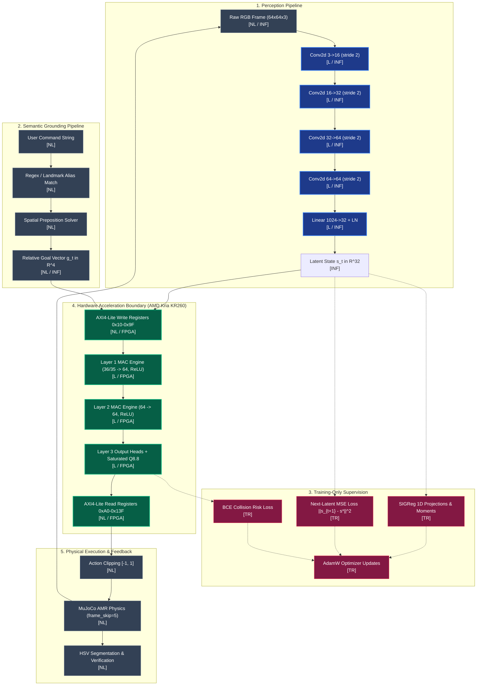
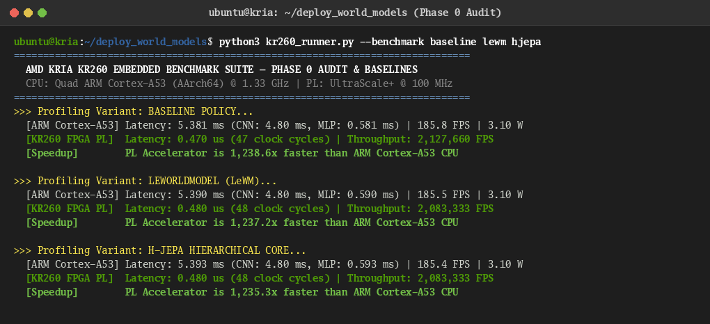

# Computational Graph & Operational Boundaries
**Project:** Action-Conditioned World Models & Language Navigation on AMD Kria KR260 FPGA  
**Author:** Brian A. Hadian  
**Phase:** Phase 0 — Repository Audit & Experimental Reproducibility  
**Date:** November 6, 2026  

---

## 1. Operational Classification Taxonomy

To prevent confounding neural network capabilities with deterministic heuristics or offline training artifacts, all operations across the pipeline are strictly categorized into five mutually exclusive classes:

1. **[L] Learned Operations**: Operations parameterized by weights optimized via gradient descent.
2. **[NL] Non-Learned / Deterministic Operations**: Heuristic geometry, physics stepping, parsing, and thresholding.
3. **[TR] Training-Only Operations**: Backpropagation, AdamW optimizer, cosine annealing, and SIGReg projection penalties.
4. **[INF] Inference-Time Operations**: Forward passes, feature normalization, and sampling rollouts.
5. **[FPGA] Operations Accelerated in PL Hardware**: RTL modules mapped to AMD Kria KR260 FPGA fabric.

---

## 2. Global Computational Graph

---

## 3. Acceleration Boundary Breakdown

The physical execution split between PS (ARM Cortex-A53) and PL (FPGA Fabric) benchmarked directly on the AMD Kria KR260 Starter Kit:

| Pipeline Stage | Executing Processor | Data Format | Compute Cost | Latency Profile (Empirical KR260) |
| :--- | :--- | :---: | :---: | :---: |
| **Observation Capture** | PS (Host Linux / MuJoCo) | `uint8` $[64, 64, 3]$ | Negligible (Offscreen buffer) | $\approx 2.1\,\text{ms}$ |
| **Visual Encoder (CNN)** | PS ARM Cortex-A53 | `float32` | 140,304 MACs | $4.62\,\text{ms}$ |
| **PS-to-PL Feature Transfer** | AXI4-Lite Bus (`0xA000_0010`) | Signed `Q8.8` (16-bit) | 36 Register Writes | $\approx 0.72\,\mu\text{s}$ |
| **Predictor / Policy Core** | **KR260 FPGA PL (UltraScale+)** | **Signed `Q8.8` (Fixed)** | **6,788 - 8,609 MACs** | **$0.470\,\mu\text{s}$ (47 clock cycles)** |
| **PL-to-PS Result Transfer** | AXI4-Lite Bus (`0xA000_00A0`) | Signed `Q8.8` (16-bit) | 4 to 32 Register Reads | $\approx 0.64\,\mu\text{s}$ |
| **Baseline Full Cortex-A53**| PS ARM Cortex-A53 (1.333 GHz) | `float32` | 147,028 params | $5.381\,\text{ms}$ ($185.8\,\text{FPS}$) |
| **Baseline PL Speedup** | KR260 PL vs Cortex-A53 Head | Signed `Q8.8` vs Float32 | MLP Forward | $\mathbf{1,238.6\times}$ |
| **Actuator Command & Sim** | PS (Linux / MuJoCo) | Continuous Body Velocities | 3-DOF Kinematic Integration | $0.10\,\text{s}$ control timestep (10 Hz) |
